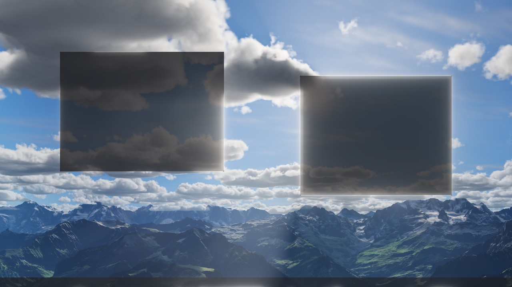
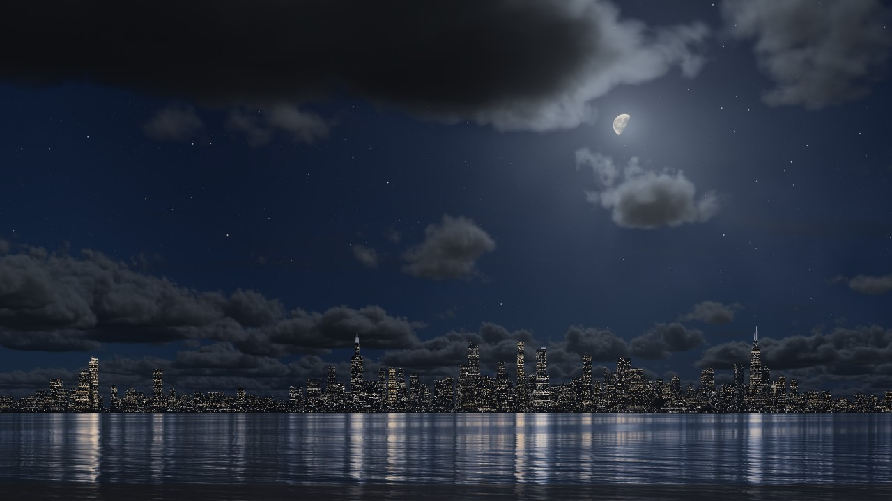
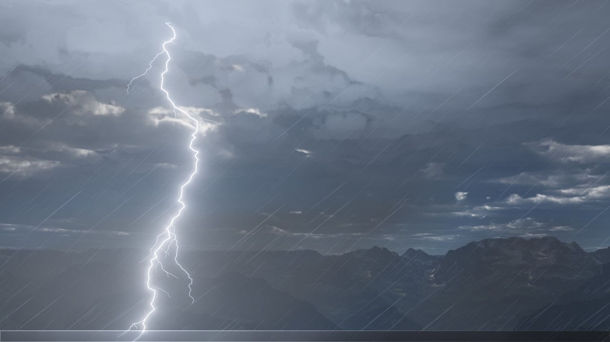
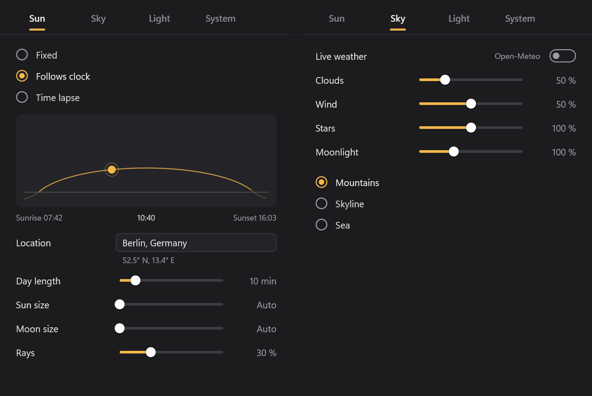

# Sunbeam

A sun in the Windows desktop background. Sunbeam draws a sky behind the desktop
icons (atmosphere, volumetric clouds, weather, sun and moon, and a ground of
mountains, a city skyline or open sea) and adds its light on top of everything
else: windows, icons, the taskbar and the mouse pointer cast shadows into the
haze, and light shafts fan out between them.


The images on this page are rendered by the program's own check mode, not
captured from a desktop. In the second one two grey rectangles stand in for
windows.



| | |
|---|---|
|  |  |
|  |  |

## What it does

- **Sun and moon** follow the clock for a place of your choice, stand where you
  drag them, or run through the day in time lapse. The moon shows its phase;
  at night there are stars and the Milky Way.
- **Clouds** in three layers with volume and their own shadows. One slider
  goes from a clear sky through overcast and rain to a thunderstorm with
  lightning. Lightning lights clouds, rain and the desktop the way the sun does.
- **Wind** moves the clouds (the high layer on a wind of its own), slants the
  rain, raises the sea and carries the dust in the light shafts.
- **Ground**: mountains (Bernese Oberland, from swisstopo terrain data), a
  skyline (Chicago, from a USGS lidar scan) or sea. Land is lit for any time of
  day; the city switches its lights on at dusk.
- **Water** reflects sky and land, shows the glitter path of sun and moon, cloud
  shadows, swell, whitecaps in fresh wind and the lights of the city as long
  columns.
- **Light**: a click-through layer above all windows adds scattered light and
  shadows, rim light on window edges and dust. HDR displays are supported.
- **Live weather** (optional) sets clouds, rain, thunderstorms and wind from
  the current weather at your place.

Sunbeam rests while a full-screen application or a maximized window covers the
desktop.

## Requirements

Windows 11 and a Direct3D 11 graphics card. Developed and tested on Windows 11
25H2 with one display (3840 x 2160 at 150 % scaling, SDR and HDR) and an NVIDIA
RTX 4070; other setups are untested. Only the primary display is used.

The program renders continuously while the desktop is visible. On the
development machine a full frame takes about 5 ms at 3840 x 2160, an
intermediate frame that only redraws the water about 2 ms.

## Build

Install Visual Studio 2022 or later (or the Build Tools) with the workload
"Desktop development with C++", which includes the Windows SDK. Then run

```
build.bat
```

The result is `out\Sunbeam.exe`; it has no other files to ship. `build.bat
shader` compiles only the shaders.

## Use

Start `Sunbeam.exe`. It adds an icon to the notification area:

- Left click opens the settings window.
- Right click opens a menu: move the sun, choose its course, pause, start with
  Windows, quit.
- The sun (or the moon at night) can be dragged on the desktop.
- Ctrl+Alt+Shift+Q quits from anywhere.

Settings are stored in `%LOCALAPPDATA%\Sunbeam\sunbeam.ini`. The file can be
edited while the program runs; changes apply when it is saved. A log is written
next to it as `sunbeam.log`.

## Location and live weather

The field **Location** on the page **Sun** takes a place name ("Lisbon",
"Springfield, Illinois") or coordinates ("46.9 7.4", "33.9 S, 151.2 E"). The
location sets the course of sun and moon and, with live weather switched on,
the weather.

Two things use the network, and only then:

- Entering a place name sends that name to the geocoding service of
  [Open-Meteo](https://open-meteo.com/). Coordinates are not looked up.
- **Live weather** on the page **Sky** is off by default. When on, the program
  asks Open-Meteo every 15 minutes for the current weather at the location,
  rounded to a tenth of a degree. Snow and fog are not drawn yet; both appear
  as a closed cloud deck.

Open-Meteo is free for non-commercial use without a key; see their
[terms](https://open-meteo.com/en/terms).

## Checks

The program can render without showing anything, for development and
measurements:

| Command | Effect |
|---|---|
| `Sunbeam.exe --sky <folder>` | Renders the sky of an empty desktop to images. Optional files in the folder: `cases.txt` (times or sun positions), `values.txt` (settings), `windows.txt`, `near.txt`, `run.txt`, `flash.txt`, `sequence.txt`, `glide.txt`, `place.txt`. |
| `Sunbeam.exe --check <folder>` | Renders a test scene and measures frame times. |
| `Sunbeam.exe --real <folder> [x y]` | Renders the image for the windows and icons currently on the desktop. Icons are drawn as blocks. |
| `Sunbeam.exe --drift <folder>` | Compares drifting clouds with a reference rendering. |
| `Sunbeam.exe --panel <folder>` | Draws the pages of the settings window to files. |
| `Sunbeam.exe --weather <folder> [place]` | Looks a place up, fetches its weather once and writes down the resulting slider positions. |
| `Sunbeam.exe --scene <file>` | Lists window classes and positions on the desktop (no titles). |
| `Sunbeam.exe --probe <folder> [seconds]` | Runs the real loop on the desktop for a few seconds without a tray icon and logs. |

The formats of the input files are described at the functions in
`src\check.cpp`.

## Source

| Path | Contents |
|---|---|
| `src\app.cpp` | Windows on the desktop, main loop, settings, tray icon |
| `src\render.cpp` | Renderer: passes, timing, sea state, lightning |
| `src\scene.cpp` | Reads windows, taskbar and icons |
| `src\panel.cpp` | Settings window (Direct2D) |
| `src\astro.cpp`, `src\daycycle.cpp` | Positions of sun and moon and their place in the image |
| `src\weather.cpp`, `src\place.cpp`, `src\net.cpp` | Live weather, place search, HTTPS |
| `src\check.cpp` | Check modes |
| `shader\sky.hlsl`, `shader\clouds.hlsli`, `shader\ground.hlsli` | Sky, clouds, rain, lightning, land and water |
| `shader\light.hlsl` | Scattered light, shadows, glare, dust |
| `ground\`, `clouds\`, `images\` | Data built into the program |
| `tools\ground\` | Scripts that produced the ground strips |

## Limits

- One display; no reaction to a lost graphics device.
- Wind direction is fixed; live weather sets only its strength.
- No snow, no fog, no sound.
- Water is a flat surface with tilted reflections; tall waves do not hide what
  is behind them.
- The skyline is missing one tower that was built after the lidar scan of 2017.

## Credits and licence

Sunbeam is released under the [MIT licence](LICENSE). It uses methods, code and
data from others, among them three-geospatial (clouds), the ocean lighting
method of Bruneton, Neyret and Holzschuch, swisstopo, the U.S. Geological
Survey, OpenStreetMap, NASA and Open-Meteo. The full list with licences is in
[CREDITS.md](CREDITS.md).
