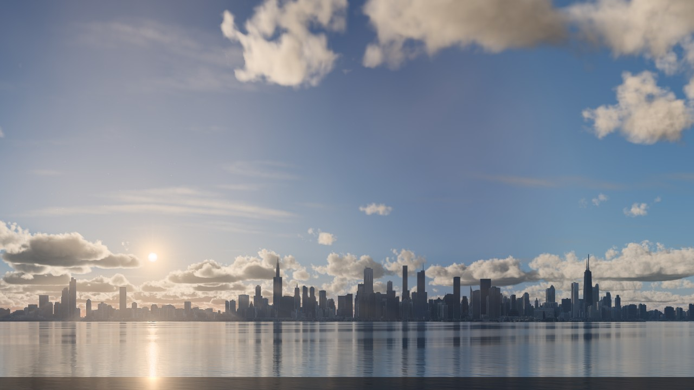

# Sunbeam

A sun in the Windows desktop background. Sunbeam draws a sky behind the desktop
icons (atmosphere, volumetric clouds, weather, sun and moon, and a ground of
mountains, a city skyline or open sea) and adds its light on top of everything
else: windows, icons, the taskbar and the mouse pointer cast shadows into the
haze, and light shafts fan out between them.



The images on this page are rendered by the program's own check mode, not
captured from a desktop. In the second one two grey rectangles stand in for
windows.


| | |
|---|---|
|  |  |
|  |  |

## What it does

- **Sun and moon** follow the clock for a place of your choice, stand where you
  drag them, or run through the day in time lapse. The moon shows its phase;
  at night there are stars and the Milky Way.
- **Clouds** in three layers with volume and their own shadows. One slider
  goes from a clear sky through overcast and rain to a thunderstorm with
  lightning. Lightning lights clouds, rain and the desktop the way the sun does.
- **Wind** moves the clouds (the high layer on a wind of its own), slants the
  rain, raises the sea and carries the dust in the light shafts.
- **Cold**: around freezing, snow falls instead of rain. In the mountains snow
  lies above a snow line that follows the temperature, down to a white winter
  panorama; in the city it lies on roofs. Without a temperature of your own the
  season at your place decides.
- **Fog** lies on water and in valleys: mist that leaves the towers of the
  skyline standing above it, a sea of fog below the mountains, or dense fog
  with a pale sun. Thin fog drifts in banks.
- **Ground**: mountains (Bernese Oberland, from swisstopo terrain data), a
  skyline (Chicago, from a USGS lidar scan) or sea. Land is lit for any time of
  day; the city switches its lights on at dusk.
- **Water** reflects sky and land, shows the glitter path of sun and moon, cloud
  shadows, swell, whitecaps in fresh wind and the lights of the city as long
  columns.
- **Life**, rarely: a ship at the sea horizon, a sailing dinghy when the wind
  suits, an airliner, a few gulls. They lie in the haze, behind clouds and rain
  according to their distance, are mirrored in the water and carry lights at
  night. Most of the time the image is empty; a slider sets how often something
  passes.
- **Light**: a click-through layer above all windows adds scattered light and
  shadows, rim light on window edges and dust. HDR displays are supported.
  The light stays on a window while it is dragged, and on the mouse pointer:
  their positions are read a thousand times a second and computed ahead to
  the display refresh in which the frame appears.
- **Live weather** (optional) sets clouds, rain or snow, thunderstorms, wind,
  fog and temperature from the current weather at your place.

Sunbeam rests while a full-screen application or a maximized window covers the
desktop, and leaves the graphics card to it.

## Requirements

Windows 11 and a Direct3D 11 graphics card. Developed and tested on Windows 11
25H2 with one display (3840 x 2160 at 150 % scaling, SDR and HDR) and an NVIDIA
RTX 4070; other setups are untested. Only the primary display is used.

The program renders continuously while the desktop is visible. On the
development machine, at 3840 x 2160, a full frame takes about 4 ms with the
default settings and about 6 ms with the scattered light at its highest
(resolution 100 %, 128 steps). While a window is dragged a frame is made for
every display refresh: at the highest settings the light takes about 2.5 ms
of it, and the sky moves on in pieces of about 1 ms in between.

How that is done: a window only shadows haze in front of it. Everything else
the scattered light depends on (clouds, mountains, icons, mist) is summed
without the windows, the haze in front of the rearmost window on a coarse
grid in depth, the haze behind it per pixel. A moving window then only costs
a step that removes what it shadows from these sums, at the two edges of its
shadow along each line of sight. `--drag` compares the result with the direct
march through the haze, which stays in the program for that purpose.

## Build

Install Visual Studio 2022 or later (or the Build Tools) with the workload
"Desktop development with C++", which includes the Windows SDK. Then run

```
build.bat
```

The result is `out\Sunbeam.exe`; it has no other files to ship. `build.bat
shader` compiles only the shaders.

## Use

Start `Sunbeam.exe`. It adds an icon to the notification area:

- Left click opens the settings window.
- Right click opens a menu: move the sun, choose its course, pause, start with
  Windows, quit.
- The sun (or the moon at night) can be dragged on the desktop.
- Ctrl+Alt+Shift+Q quits from anywhere.

Settings are stored in `%LOCALAPPDATA%\Sunbeam\sunbeam.ini`. The file can be
edited while the program runs; changes apply when it is saved. A log is written
next to it as `sunbeam.log`.

## Location and live weather

The field **Location** on the page **Sun** takes a place name ("Lisbon",
"Springfield, Illinois") or coordinates ("46.9 7.4", "33.9 S, 151.2 E"). The
location sets the course of sun and moon and, with live weather switched on,
the weather.

Two things use the network, and only then:

- Entering a place name sends that name to the geocoding service of
  [Open-Meteo](https://open-meteo.com/). Coordinates are not looked up.
- **Live weather** on the page **Sky** is off by default. When on, the program
  asks Open-Meteo every 15 minutes for the current weather at the location,
  rounded to a tenth of a degree. The temperature is carried up to the viewer:
  the mountain view is from 2365 m, about 15 degrees colder than a place in the
  lowlands, so rain down there is often snow up here.

Without live weather the sliders **Fog** and **Temperature** apply. Temperature
at its left end reads **Season**: a rough climate from the latitude of the
location and the date, warmer in the afternoon than at night.

Open-Meteo is free for non-commercial use without a key; see their
[terms](https://open-meteo.com/en/terms).

## Checks

The program can render without showing anything, for development and
measurements:

| Command | Effect |
|---|---|
| `Sunbeam.exe --sky <folder>` | Renders the sky of an empty desktop to images. Optional files in the folder: `cases.txt` (times or sun positions), `values.txt` (settings), `windows.txt`, `near.txt`, `run.txt`, `flash.txt`, `sequence.txt`, `glide.txt`, `place.txt`, `props.txt` (ships, aircraft and birds to place in the image). |
| `Sunbeam.exe --check <folder>` | Renders a test scene and measures frame times. |
| `Sunbeam.exe --real <folder> [x y]` | Renders the image for the windows and icons currently on the desktop. Icons are drawn as blocks. |
| `Sunbeam.exe --drift <folder>` | Compares drifting clouds with a reference rendering. |
| `Sunbeam.exe --panel <folder>` | Draws the pages of the settings window to files. |
| `Sunbeam.exe --life <folder>` | Lets two days pass per ground and writes down how often ships, aircraft and birds appeared and for how long. |
| `Sunbeam.exe --weather <folder> [place]` | Looks a place up, fetches its weather once and writes down the resulting slider positions. |
| `Sunbeam.exe --scene <file>` | Lists window classes and positions on the desktop (no titles). |
| `Sunbeam.exe --drag <folder> [x y]` | Measures what a frame costs at rest and while a window is dragged, part by part, and compares the scattered light with the direct march through the haze (difference images). `quick.txt` in the folder: timings only; `compare.txt`: comparison only. |
| `Sunbeam.exe --pace <folder> [x y]` | Simulates a pointer and a window that follows it, makes a frame for every display refresh and writes down how far the light was from the window when the frame appeared, and the shadow of the pointer from the pointer. |
| `Sunbeam.exe --probe <folder> [seconds] [blind]` | Runs the real loop on the desktop for a few seconds without a tray icon and logs. With `blind` nothing appears on the screen. |

The formats of the input files are described at the functions in
`src\check.cpp`. Check runs only take what other programs leave of the
graphics card, so timings are only valid while the card is free; with the
environment variable `SUNBEAM_FULL` set they take their normal share. With
`SUNBEAM_ADAPTER` set to part of the name of a graphics card, they run on that
card.

## Source

| Path | Contents |
|---|---|
| `src\app.cpp` | Windows on the desktop, main loop, settings, tray icon |
| `src\render.cpp` | Renderer: passes, timing, sea state, lightning |
| `src\scene.cpp` | Reads windows, taskbar and icons |
| `src\motion.cpp` | Follows the pointer and a dragged window and computes ahead where they will be; pace of the display |
| `src\panel.cpp` | Settings window (Direct2D) |
| `src\astro.cpp`, `src\daycycle.cpp` | Positions of sun and moon and their place in the image |
| `src\weather.cpp`, `src\place.cpp`, `src\net.cpp` | Live weather, place search, HTTPS |
| `src\life.cpp` | When a ship, an aircraft or birds appear, and how they move |
| `src\check.cpp` | Check modes |
| `shader\sky.hlsl`, `shader\clouds.hlsli`, `shader\ground.hlsli` | Sky, clouds, rain, lightning, land and water |
| `shader\light.hlsl` | Scattered light, shadows, glare, dust |
| `ground\`, `clouds\`, `images\`, `models\` | Data built into the program |
| `tools\ground\` | Scripts that produced the ground strips |
| `tools\models\` | Script that converted the models |

## Limits

- One display; no reaction to a lost graphics device.
- The position of a dragged window is computed ahead from the mouse pointer.
  A window that does not follow the pointer in a steady way, or that moves
  without the mouse, is taken as last read: the light is then up to one
  refresh behind it.
- Wind direction is fixed; live weather sets only its strength.
- No sound.
- Snow lies on the land but does not pile up on ships or freeze the water; the
  season knows the latitude, not the climate of a particular place.
- Fog is a level layer with banks; it has no relief when seen from above.
- Water is a flat surface with tilted reflections; tall waves do not hide what
  is behind them.
- The skyline is missing one tower that was built after the lidar scan of 2017.
- Ships leave no wake, the dinghy sails without a crew, and nothing casts a
  shadow onto itself.

## Credits and licence

Sunbeam is released under the [MIT licence](LICENSE). It uses methods, code and
data from others, among them three-geospatial (clouds), the ocean lighting
method of Bruneton, Neyret and Holzschuch, swisstopo, the U.S. Geological
Survey, OpenStreetMap, NASA and Open-Meteo, and models by RM02, hungry_drifter,
MesXwi, Julian Johnson-Mortimer and mgg8, which keep their own licences (CC BY
4.0 and CC0). The full list with licences is in [CREDITS.md](CREDITS.md).
